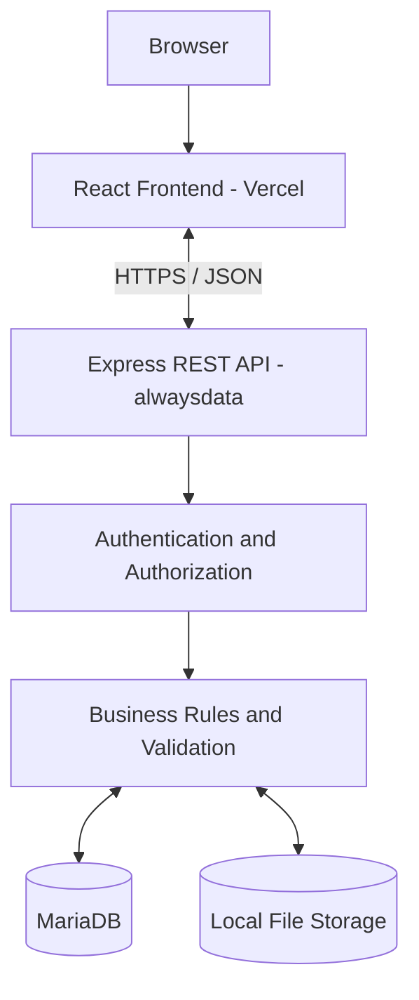
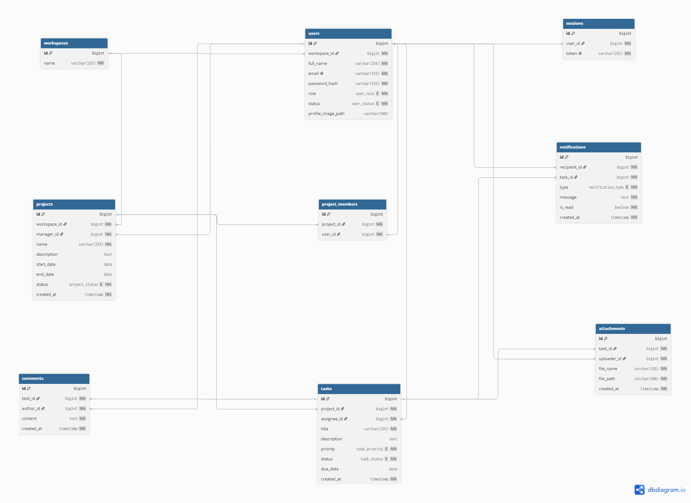
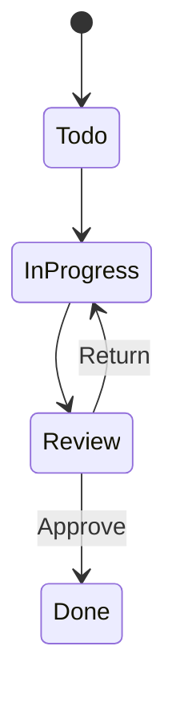

# Tasky

Tasky is a full-stack project and task management application designed to help small teams organize projects, assign tasks, track progress, and collaborate within a shared Workspace.

Developed as a software engineering portfolio project, Tasky focuses on backend engineering, REST API design, relational database modeling, authentication, authorization, business logic, data integrity, and full-stack integration.

**Live Demo:** [tasky-seven-dun.vercel.app](https://tasky-seven-dun.vercel.app)

## Key Features

- Workspace and user account management.
- Role-based access control: Admin, Manager, and Member.
- Project management and lifecycle control.
- Task assignment, reassignment, and review workflows.
- Task priorities, due dates, and overdue detection.
- Comments and file attachments.
- Profile image management.
- In-app notifications.
- Project and Task search and filtering.
- Protected navigation and persistent authentication sessions.

## Engineering Highlights

This project demonstrates:

- Requirements analysis and MVP scope definition.
- Functional and non-functional requirements documentation.
- RESTful API design and implementation.
- Modular backend architecture.
- Relational database design and SQL queries.
- Session-based authentication.
- Role-based and object-level authorization.
- Workspace-level data isolation.
- Business rule enforcement and input validation.
- File upload, protected delivery, and destructive cleanup.
- Manual API testing and end-to-end verification.
- Full-stack deployment and production configuration.
- Milestone-based development and Git version control.

## Technology Stack

| Category | Technologies |
|---|---|
| Frontend | React, TypeScript |
| Routing | React Router |
| HTTP Client | Axios |
| Styling | Bootstrap, CSS |
| Backend | Node.js, Express, TypeScript |
| Database | MySQL-compatible SQL, MariaDB |
| Database Driver | mysql2 |
| Authentication | Server-side sessions, bcrypt, Node.js crypto |
| File Uploads | Multer |
| File Management | Node.js fs, path |
| API Testing | Postman |
| Version Control | Git, GitHub |
| Frontend Hosting | Vercel |
| Backend Hosting | alwaysdata |
| Database Hosting | alwaysdata |

## System Architecture

Tasky follows a separated frontend and backend architecture.



The frontend communicates with the backend through HTTP requests using Axios. The backend processes requests, validates authentication and permissions, enforces business rules, and interacts with the database and file storage.

The frontend never connects directly to the database.

## Backend Architecture

The backend uses a modular Express architecture with responsibilities separated into:

| Component | Responsibility |
|---|---|
| server.ts | HTTP server startup |
| app.ts | Express configuration, CORS, middleware, route registration, and error handling |
| db.ts | Database connection pool |
| middleware/auth.ts | Authentication and role-based authorization |
| middleware/permissions.ts | Reusable object-level permission checks |
| routes/ | Feature-based REST API endpoints |
| uploads/ | Local storage for attachments and profile images |

Route modules contain request validation, business rules, and parameterized SQL queries.

The architecture intentionally avoids unnecessary abstraction layers and additional frameworks to keep the MVP straightforward and maintainable.

## REST API Design

The backend exposes resource-oriented REST endpoints using standard HTTP methods and JSON responses.

### Example Endpoints

| Method | Endpoint | Description |
|---|---|---|
| POST | /auth/register | Register a Workspace and Admin |
| POST | /auth/login | Authenticate a user |
| GET | /auth/me | Validate the current session |
| POST | /auth/logout | Invalidate the current session |
| GET | /projects | List accessible Projects |
| POST | /projects | Create a Project |
| GET | /projects/:id/tasks | List Project Tasks |
| POST | /projects/:id/tasks | Create a Task |
| PATCH | /tasks/:id | Update a Task |
| DELETE | /tasks/:id | Delete a Task |
| GET | /tasks/:id/comments | List Task Comments |
| GET | /attachments/:id/download | Download a protected Attachment |
| GET | /notifications | List user Notifications |

The API uses appropriate HTTP status codes to distinguish successful requests, validation failures, authentication failures, permission violations, missing resources, and unexpected server errors.

Search and filtering are implemented through query parameters.

See the [REST API Documentation](docs/API.md) for the complete endpoint reference.

## Authentication and Authorization

### Session-Based Authentication

Tasky implements custom server-side session authentication rather than JWT.

1. User credentials are validated against the database.
2. Passwords are verified using bcrypt.
3. A random session token is generated using Node.js crypto.
4. The session is stored in the database.
5. The frontend stores the token in localStorage.
6. Axios includes the token in subsequent protected requests.
7. Authentication middleware validates the session and the user's account status.
8. Logout invalidates the session and removes the locally stored token.

Protected requests use the following HTTP header:

```http
Authorization: Bearer <session-token>
```

The frontend validates existing sessions when the application starts, allowing authentication to persist across page refreshes.

### Role-Based Authorization

| Role | Responsibilities |
|---|---|
| Admin | Workspace administration, user management, Project creation, and Workspace-level control |
| Manager | Management of assigned Projects, Project Members, Tasks, and Task reviews |
| Member | Participation in assigned Projects, execution of assigned Tasks, and collaboration |

### Workspace Isolation

Workspace isolation is enforced by the backend.

The authenticated session determines the current user's identity, role, and Workspace. Protected database queries and resource lookups enforce the appropriate Workspace, Project, and object-level permissions.

Frontend visibility restrictions improve usability, but the backend remains the final authority for authorization.

## Database Design

Tasky uses a relational database with nine core tables.

| Table | Purpose |
|---|---|
| workspaces | Workspace information |
| users | User accounts, roles, and account status |
| projects | Projects and responsible Managers |
| project_members | Project membership relationships |
| tasks | Assigned Tasks and workflow states |
| comments | Task discussions |
| attachments | Uploaded-file metadata |
| notifications | User-specific Notifications |
| sessions | Authentication sessions |

### Entity Relationship Diagram



### Data Integrity

Data integrity is maintained through:

- Primary and foreign keys.
- Unique email addresses.
- Unique session tokens.
- Composite unique constraints preventing duplicate Project membership.
- Required fields and enumerated values.
- Backend validation of relationships and business rules.
- Parameterized SQL queries.
- Explicit cleanup of dependent records and uploaded files during destructive operations.

Rules involving multiple entities, roles, and workflow states are enforced by the backend in addition to database constraints.

See the [Database Design Documentation](docs/ERD.md) and [SQL Schema](database/schema.sql).

## Business Logic

### Task Workflow



The main Task workflow separates Task execution from approval.

- New Tasks start in Todo.
- Members submit assigned Tasks for review.
- Members cannot independently mark Tasks as Done.
- Authorized Managers and Admins approve or return submitted Tasks.
- Reassigning a Task automatically resets its status to Todo.
- Task due dates must respect Project date boundaries.
- Overdue status is derived from the due date and current Task status.

### Project Lifecycle

Projects support three lifecycle states:

- Active
- Completed
- Archived

A Project can only become Completed when all its Tasks are Done. Projects may also be Archived before completion.

Completed and Archived Projects are read-only until reactivated by an Admin.

### Additional Business Rules

- Every Project has exactly one responsible Manager.
- Tasks can only be assigned to eligible Project Members.
- Members with unfinished assigned Tasks cannot be removed before reassignment.
- Managers responsible for Projects cannot be disabled before transferring their responsibilities.
- Completed Tasks preserve historical assignee information.
- Destructive actions coordinate the deletion of dependent records and uploaded files.

## File Handling

Tasky supports Task attachments and user profile images using Multer.

Uploaded files are stored on the backend filesystem, while the database stores file references and metadata.

Task attachments have a maximum size of 10 MB per file.

Files are delivered through protected backend endpoints rather than public static directories. Authentication and applicable resource permissions are checked before file delivery.

Task, Project, and Workspace deletion operations include cleanup of associated uploaded files.

## Notifications

Tasky implements database-backed in-app notifications.

Supported notification events include:

- Task assignment.
- Task submission for review.
- Task approval.
- Task return.
- New comments.

Notifications are associated with individual recipients and support read and unread states.

The frontend periodically requests the unread notification count using Axios polling rather than maintaining a persistent WebSocket connection.

## Technical Decisions and Trade-offs

| Decision | Rationale |
|---|---|
| Direct SQL instead of an ORM | Demonstrate relational database design and explicit query construction |
| Server-side sessions instead of JWT | Support server-controlled session validation and invalidation |
| Modular Express route handlers | Keep the backend architecture appropriate for the MVP's complexity |
| Local file storage | Avoid introducing an additional cloud storage dependency |
| Axios polling instead of WebSockets | Provide notification updates with simpler infrastructure |
| React Context for authentication | Avoid unnecessary global state management dependencies |
| Free hosting services | Make the portfolio application publicly accessible without paid infrastructure |

### MVP Limitations

Tasky intentionally maintains a limited scope.

- Designed primarily for desktop browsers.
- No email verification.
- No native mobile application.
- No WebSocket-based real-time communication.
- No advanced activity or audit logging.
- No database transactions for multi-step operations.
- No comprehensive automated test suite.

Additional production hardening, including database network restrictions, secret handling, and process-crash recovery verification, remains potential future work.

## Testing and Verification

Tasky was developed using milestone-based implementation and manual verification.

### API Testing

Postman was used to verify:

- Authentication and session handling.
- Authorized and unauthorized requests.
- Workspace isolation.
- Role and resource permissions.
- Request validation.
- HTTP status codes and error responses.
- Business rules.
- Data and file deletion.

### End-to-End Testing

Manual testing covered the complete core workflow:

```text
Registration
    ↓
Team Account Creation
    ↓
Project Creation
    ↓
Project Membership
    ↓
Task Assignment
    ↓
Task Execution
    ↓
Review and Approval
    ↓
Project Completion
```

### Verification Results

- 28/28 PRD acceptance criteria passed manual verification.
- 9/9 end-to-end and release checks completed.
- Production registration and authentication verified.
- Core Project and Task workflows verified on the deployed application.
- Attachment upload, download, and persistence verified.
- Protected file delivery tested.
- Production route navigation and page refresh verified.

The verification process is documented in the [Development Plan](docs/PLAN.md).

## Deployment

Tasky is deployed using free hosting services.

| Component | Hosting Service |
|---|---|
| React Frontend | Vercel |
| Express Backend | alwaysdata |
| MariaDB Database | alwaysdata |
| Uploaded Files | alwaysdata local filesystem |

The frontend communicates with the backend over HTTPS.

Environment-specific configuration is provided through environment variables, and backend CORS is configured for the deployed frontend origin.

**Live Demo:** [Open Tasky](https://tasky-seven-dun.vercel.app)

## Project Structure

```text
Tasky/
├── backend/
│   ├── middleware/
│   ├── routes/
│   ├── uploads/
│   ├── app.ts
│   ├── db.ts
│   ├── server.ts
│   └── package.json
├── frontend/
│   ├── public/
│   ├── src/
│   │   ├── components/
│   │   ├── context/
│   │   ├── pages/
│   │   ├── App.tsx
│   │   └── index.tsx
│   └── package.json
├── database/
│   └── schema.sql
├── docs/
│   ├── PRD.md
│   ├── TECH_STACK.md
│   ├── ARCHITECTURE.md
│   ├── API.md
│   ├── ERD.md
│   ├── ERD.png
│   └── PLAN.md
└── README.md
```

## Local Setup

### Prerequisites

- Git
- Node.js and npm
- MySQL or a compatible MariaDB installation
- A modern desktop browser

### 1. Clone the Repository

```bash
git clone https://github.com/omrsag/Tasky.git
cd Tasky
```

### 2. Initialize the Database

Create a database named tasky:

```sql
CREATE DATABASE tasky;
```

Create a dedicated local database user with the required permissions, then import the schema from:

```text
database/schema.sql
```

For example, using a Bash-compatible terminal:

```bash
mysql -u root -p tasky < database/schema.sql
```

The schema can also be imported through phpMyAdmin.

### 3. Configure the Backend

The backend reads its configuration from environment variables.

| Variable | Description | Example |
|---|---|---|
| DB_HOST | Database hostname | localhost |
| DB_USER | Database username | tasky_app |
| DB_PASSWORD | Database password | Your local password |
| DB_NAME | Database name | tasky |
| DB_PORT | Database port | 3306 |
| FRONTEND_URL | Allowed frontend origin | http://localhost:3000 |
| PORT | Backend port | 3001 |

For example, using Bash:

```bash
export DB_HOST=localhost
export DB_USER=tasky_app
read -rs -p "Database password: " DB_PASSWORD
export DB_PASSWORD
export DB_NAME=tasky
export DB_PORT=3306
export FRONTEND_URL=http://localhost:3000
export PORT=3001
```

The backend does not automatically load .env files.

Never commit database credentials or other secrets to the repository.

### 4. Install and Start the Backend

```bash
cd backend
npm ci
npx tsc
node dist/server.js
```

The backend should be available at:

```text
http://localhost:3001
```

### 5. Configure and Start the Frontend

Open a separate terminal from the repository root:

```bash
cd frontend
npm ci
```

Create a local .env.local file inside the frontend directory containing:

```dotenv
REACT_APP_API_URL=http://localhost:3001
```

Start the React application:

```bash
npm start
```

Open:

```text
http://localhost:3000
```

Register a new account to create a Workspace and begin using Tasky.

## Documentation

The project includes dedicated product and technical documentation.

| Document | Description |
|---|---|
| [PRD](docs/PRD.md) | Product requirements, use cases, MVP scope, and acceptance criteria |
| [Technology Stack](docs/TECH_STACK.md) | Technologies and implementation choices |
| [Architecture](docs/ARCHITECTURE.md) | System structure and component interactions |
| [API Documentation](docs/API.md) | REST endpoints, permissions, and request behavior |
| [Database Design](docs/ERD.md) | Database entities, relationships, and integrity rules |
| [Development Plan](docs/PLAN.md) | Implementation milestones and verification tasks |

## Development Approach

Tasky follows a structured software development process:

1. Requirements discovery and MVP definition.
2. System architecture and technology selection.
3. Relational database design.
4. REST API design.
5. Backend implementation and manual API testing.
6. Frontend implementation and integration.
7. End-to-end acceptance testing.
8. Deployment and production verification.
9. Technical documentation.

Development is organized into 24 milestones, using Git branches, commits, and Pull Requests to track implementation progress.

## Author

**Omar Saghir**

Software Engineering Portfolio Project

[GitHub](https://github.com/omrsag)